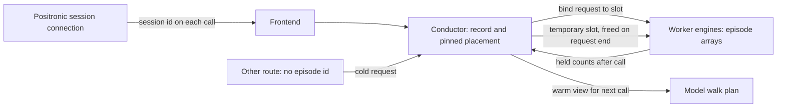
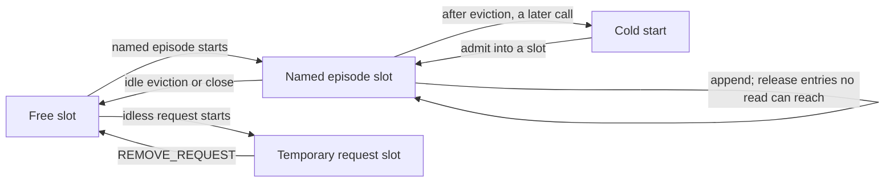

# Episode state across requests (design, not implemented)

Status: proposed, for agreement on the contract before any code. The motivating case is Praxis-1 (#1460), a robot policy whose next call is conditioned on what the robot did since its last call.

M* has content-keyed caches across requests (the prefix cache, Chatterbox's voice conditioning), but nothing keyed by a client. A robot client over openpi's WebSocket (#1204) sends one request per observation, so anything a policy wants to carry from one call to the next (text embeddings computed once per task, the executed past that conditions the next chunk) is gone when each call ends. AGENTS.md invariant 1 puts session state in the system, not the model. This design adds that state as a system concept, an **episode**: a sequence of requests from one client that share retained arrays, which the model declares and the engine holds, so the model object keeps no mutable per-session state.

| Part | Section |
|---|---|
| What happens today | §0 |
| What the reference keeps | §1 |
| The contract | §2 |
| Identity | §3 |
| Reset | §4 |
| What is retained, and where | §5 |
| Memory limits | §6 |
| Cleanup | §7 |
| Concurrent requests | §8 |
| Praxis-1 and other users | §9 |
| Migration and compatibility | §10 |
| Open questions | §11 |

---

## 0. What happens today

- **A call is a request.** The Python openpi handler submits one request per observation with no request id ([openpi.py](../../mstar/api_server/openpi.py) `_infer`, lines 240-248), so `submit_request` mints a fresh uuid4 ([entrypoint.py](../../mstar/api_server/entrypoint.py) lines 855-856). The Rust handler does the same with `rid("openpi")` ([ws/openpi.rs](../../rust/server/src/ws/openpi.rs) line 521, [serving.rs](../../rust/server/src/serving.rs) lines 328-330). Both send the prompt on every call (`openpi.py` lines 202-206, `openpi.rs` lines 463-467).
- **A socket runs one call at a time.** Both loops receive, wait for the reply and send it before reading again (`openpi.py` lines 281-303, `openpi.rs` lines 563-613). Any failure answers with the error as text and closes the socket (`openpi.py` lines 295-298, `openpi.rs` lines 593-605).
- **A persist edge lasts one request.** Persisted signals live on the request's `RequestData` (`persist_signals`, [conductor.py](../../mstar/conductor/conductor.py) lines 372-375), seeded from what the data worker stored for this request ([data_worker.py](../../mstar/api_server/data_worker.py) lines 1112 and 1124). A later pass replaces what an earlier pass held under a name (`conductor.py` lines 1977-1993). When the request is done, the conductor unpersists everything still held (lines 1894-1902) with `UNPERSIST_TENSORS`, the producer clears the flag ([input_ingest.py](../../mstar/worker/input_ingest.py) lines 282-285), and the tensor store frees the tensor once its references drop ([rust/src/tensors.rs](../../rust/src/tensors.rs) lines 792-797).
- **The plan is decided at ingest, from this request's signals only.** The conductor calls `walk_plan` with `body.initial_signals` (`conductor.py` lines 1397-1401; the contract is [base.py](../../mstar/model/base.py) lines 999-1027). A walk input with no persisted signal gets an empty edge ([request_info.py](../../mstar/conductor/request_info.py) lines 102-110).
- **Engine state is per request.** A declared array is "per request, per label and per declared layer" ([contract.py](../../mstar/engine/state/contract.py) line 213). The engine registers a request's state on its first `NEW_REQUEST` ([input_ingest.py](../../mstar/worker/input_ingest.py) lines 199-216, `Engine.add_request` in [engine.py](../../mstar/engine/engine.py) line 3906), every resource keys it by the worker's request handle, and all of it is purged on `REMOVE_REQUEST` ([rid_table.py](../../mstar/worker/rid_table.py) lines 8-31, `Engine.remove_request`, `engine.py` lines 3937-3954).
- **The only cross-request reuse is content-keyed.** The prefix cache keeps a finished request's KV pages under a hash of what they depend on (`Model.kv_labels`, `base.py` lines 885-895, and `.claude/skills/prefix-caching/SKILL.md`), and Chatterbox keeps an LRU of voice conditioning by the clip's hash ([chatterbox/submodules.py](../../mstar/model/chatterbox/submodules.py) lines 88-108). The replica router places each request on its own (`ReplicaRouter.pick`, [routing.py](../../mstar/conductor/routing.py) line 177). Nothing is keyed by a client.
- **The one long-lived call is a request with open client input** (client streams, [topology.py](../../mstar/streaming/topology.py) lines 30-35; the realtime conversation, [realtime/conversation.rs](../../rust/server/src/realtime/conversation.rs) lines 6-8). At capacity the conductor refuses such a call rather than queueing it (`conductor.py` lines 1291-1298).

So for #1460 as written: `walk_plan` never finds `text_embeds` from a prior call, and `encode_text` runs on every call. Predicted video latents end at the denoise loop; they do not become context for a later call.

---

## 1. What the reference keeps per episode

The reference server (`praxis-1-oss`) keeps one session per WebSocket connection (`praxis/serve/server.py` lines 9-11), built when the socket opens and dropped in a `finally` when it closes (lines 134-167). Its protocol v2 also mints a `session_id` per connection (lines 148-154) and takes `end_session` (lines 199-205). The table describes a chunked session, where each call answers one chunk; a real-time session (`schedule=rtc`) gets one sample per call and also keeps a sample history and precomputed work (`policy.py` lines 605-711), which this design does not try to cover.

| State | Size | Lifetime |
|---|---|---|
| Executed frame window (`ContiguousStreamContext`, `praxis/robot_io.py` lines 298-336) | float32 clips `(1, 3, T, 256, 832)` on the GPU (tile 256x416, two views, `single_arm.py` lines 94 and 461-466): 2.44 MiB a frame. `T <= 21 + 24 (d - 1)`: 21 frames (51 MiB of window) at the server default of one context chunk (`policy.py` line 64), 69 frames (168 MiB) at three. These are the logical window; the slice keeps the concatenated buffer under it, so the allocation is larger (`robot_io.py` lines 403-419). As uint8 the window would be a quarter of that. | Grows by the executed chunk each call, drops the oldest 24 frames past the cap; cleared by a context restart |
| Boundary latents and poses (`single_arm.py` lines 1094-1097, 1185-1191) | the last `d + 1` single-frame latents and 8-float poses, under 1 MiB | as the window |
| Text embeddings (`praxis/pipeline.py` lines 121, 145-148) | `(1, S, 2048)` bf16 (`text_encoder.py` line 169), 4 KiB a token, plus the blank caption | memoized for the whole process by prompt string, not per session |
| `chunk_index` (`single_arm.py` lines 1093, 1290) | an int | counts completed chunks: seeds chunk k with `base + k` (`pipeline.py` line 469) and counts the budget; reset only at session end |
| Prompt (`single_arm.py` lines 1139-1144) | a string | an observation's `prompt` replaces it without restarting the context |

How it resets and ends:

- **Context restart.** An observation's `reset_context` (or `__reset_context__`) drops the window and the boundary state, but keeps `chunk_index` (`single_arm.py` lines 1105-1115 and 1137-1138). The session also restarts by itself when the frame stack is missing or too short (line 1173), when a real-time gap is off the frame grid (`policy.py` lines 678-691), and on every call in stateless mode (lines 571-572).
- **Episode end.** Closing the socket or `end_session` calls `close`, which drops the context and resets `chunk_index` (`policy.py` lines 769-780); the session object is then discarded. The process-wide text memo survives.
- **Budget.** `max_chunks_per_episode` (default unset, `policy.py` line 72) is checked at the start of a call (lines 567-570). Past it the server sends the error and stops reading (`server.py` lines 267-271).
- **A failed call ends the session**, since it may have changed the context (`server.py` lines 272-279).
- **Concurrency.** All calls of all sessions run one after another on one thread (`server.py` lines 44-45), so there is no batching across sessions. Real-time sessions may have 16 calls in flight (`periodic.py` line 66), and they are served in order.

Two facts here shape the design. The context is the **executed real frames**, which a chunked client sends as a frame stack of up to 25 frames each call; conditioning on the model's own predicted video ("rolling") is refused because the model trained on real frames only (`policy.py` lines 271-276). And the server retains frames only because a context of more than one chunk spans more frames than one observation carries.

---

## 2. The contract

An episode is named by the frontend, owned by the conductor, and held by the engines of the workers its arrays live on. A model declares what it retains as arrays with `lifetime="episode"` in `declare_state`. The conductor gives each episode one logical slot identity for admission and ownership; each storage maps that identity to its own dense, paged or ring allocation. A request's steps read what earlier requests kept and append their own, and `walk_plan` sees how much each array holds, so it can skip work whose result is retained. A request without an episode id uses a temporary identity for any episode arrays its model declares; its data is released on `REMOVE_REQUEST`, so it starts cold on every call. Models with no episode arrays take the existing path without a slot.

```python
# mstar/engine/state/contract.py
@dataclass(frozen=True)
class Array:
    ...
    max_len: int | None           # None: unbounded logical log with a provable resident bound
    lifetime: Literal["request", "episode"] = "request"   # episode: kept across the episode's requests

# what walk_plan and step_metadata see; built by the conductor, not by the model
class EpisodeView(NamedTuple):
    id: str | None              # None: a request with no episode, which starts cold every call
    calls: int                  # calls of this episode admitted before this one
    held: Mapping[str, int]     # episode array -> entries it holds now (0 after a reset or an eviction)
    cold: str | None            # why held is empty when calls > 0: "reset", "evicted", "idle", "lost"

# mstar/model/base.py
class ProcessPromptOutput(NamedTuple):
    ...
    episode_keys: Mapping[str, str] = MappingProxyType({})   # episode array -> what its entries were made from
    reset_episode: bool = False                              # a context restart, asked from this request's inputs
```

```yaml
# serving config
episodes:
  max_episodes: 16        # episode identities per replica; capacity follows declarations and read bounds
  idle_timeout_s: 600     # an episode with no call for this long is ended
  max_calls: null         # the reference's max_chunks_per_episode; null is unbounded
  max_queued_calls: 1     # calls of one episode waiting behind the one in flight
```

The id follows a connection; the retained tensors stay on workers. A later call
uses the same placement and slot, while an idless call borrows a slot only for
its own request:



---

## 3. Episode identity

**Proposal.** Once E4 lands, the Positronic frontend mints an episode id for each `/api/v1/session` WebSocket connection when it opens, and every call on that socket carries it. Positronic protocol v2 sends a 32-hex `session_id` in its ready frame, requires that same value in every request and rejects a mismatch (`server.py` lines 148-154 and 199-208); that connection-bound value is also its internal episode id. The id goes to `submit_request` as a system field beside `request_id` (`episode=`; `SubmitArgs.episode` in Rust), not in `model_kwargs`, through the data worker to `NewRequestConductor.episode`. A model with no episode arrays runs as today. An idless request to a model with episode arrays gets a temporary slot and a cold `EpisodeView` (§5), without creating an episode record.

The conductor keeps one record per episode:

```python
@dataclass(slots=True)
class EpisodeRecord:
    calls: int                  # admitted calls
    placement: Placement        # the replica of each node group, fixed by the first call
    slot: int                   # logical ownership/admission id, the same on every lockstep rank
    held: dict[str, int]        # entries per array, from the workers' WORKER_GRAPHS_DONE
    keys: dict[str, str]        # what each array's entries were made from
    in_flight: str | None       # the request running now
    queued: deque               # calls waiting behind it (§8)
    last_end: float             # for the idle timeout and LRU (§6, §7)
```

Why this shape:

- **The Positronic connection is the episode.** The reference opens one session per connection and ends it when the connection closes. A connection-scoped id follows that lifecycle.
- **Minted by the system, never chosen by the client.** A client-chosen id can collide with or guess another client's, so it needs scoping to the caller's credentials, and its only cleanup is a timeout. It also survives a reconnect, which the reference does not attempt: a new connection starts cold there. This is left as an open question (§11), and the field is shaped so it can be added.
- **The conductor owns the record.** It already owns the request lifecycle and the replica pick, and it must decide eviction and slot assignment so every rank of a lockstep instance agrees (invariant 11). A record on a worker would need rank 0 to journal its choices.
- **The placement is pinned.** The retained arrays live on the replica the first call ran on, so later calls skip `ReplicaRouter.pick` and go there.

Rejected:

- **A derived id** (a hash of the prompt, the robot's state keys or the client address): two robots on one task, or behind one NAT, would share an episode.
- **No id, the client sends its context back.** The client already sends the last executed chunk, but a context of more than one chunk needs more frames than an observation carries (69 against 25 at three chunks), and every call would ship and re-check them. It also leaves text embeddings recomputed every call. The maintainers' question was this choice, and the decision was system-owned state.

---

## 4. Reset

**Proposal.** Three ways a context restarts, and one way an episode ends early:

1. **Explicit.** An observation with `reset_context: true` (or `__reset_context__`, as the reference reads it) sets `episode.reset` on its request. Both frontends' Positronic handlers read the key.
2. **Model-requested.** `process_prompt` sets `reset_episode` when this request's inputs can't continue the context: the reference's missing or short frame stack is the case. The data worker ORs it with the client's flag.
3. **System.** An evicted, idle-ended or lost episode starts its next call cold (§6, §7), with `EpisodeView.cold` giving the internal reason. Whether the wire exposes it is open (§11).
4. **Budget.** `episodes.max_calls` refuses the call past it with a 400, `episode reached max_calls=N`. Both frontends answer a failure with its text and close the socket, which ends the episode (§7).

A restart clears every episode array of the episode before the request's first step: the conductor marks the request's `NEW_REQUEST` to the episode's workers, and each engine empties the slot when it binds the request. `calls` keeps counting, as the reference's `chunk_index` does, so the seed sequence and the budget run over the whole connection.

An array also clears when its key changes. A request's `episode_keys` names what each array's entries are made from (for text embeddings, a digest of the prompt's token ids, which the data worker has). When the key differs from the record's, the conductor treats that array as empty for this request (`held[name] = 0`) and the engine clears it on bind, so `walk_plan` runs the producer again. This is what lets a prompt change mid-episode re-encode the text without dropping the frame window, as the reference allows.

Why this shape:

- **A restart is not an episode end.** The reference keeps `chunk_index` across `reset_context`, and a client that reuses one socket for many episodes would otherwise have to reconnect to reset its budget.
- **Applied on bind, not by a separate message.** The flag rides the request it belongs to, so it is ordered with that request on every rank and can't race the previous call's commit.
- **The model asks; the engine clears.** The model can see that a stack is too short, but holds nothing it could clear.

Rejected:

- **Implicit reset on a prompt change.** The reference changes the prompt without restarting the context, and the key rule covers the one array that depends on the prompt.
- **Resetting silently at `max_calls`.** The robot would keep moving on a cold context; the reference stops the session.
- **Keeping some arrays across a restart.** Clearing everything is the initial rule, and re-encoding a prompt costs one text-encoder pass. A different scope needs a concrete model use case.

---

## 5. What is retained, and where

**Proposal.** A model declares each retained thing as an `Array` with `lifetime="episode"`:

- An integer `max_len` keeps its current meaning: the maximum logical log length, with zero still meaning scratch within a step. `max_len=None` declares an unbounded logical log, initially only for append-only dense arrays with no positions and only no-op `Window` reads. Every read is from the current tail; arbitrary or backward queries are refused. The largest declared window bounds resident entries, plus room for an in-flight append and staging. There is no separate retention field.
- `nodes` say which node reads and writes it; the array lives on the workers that run that node, inside their engines, with one episode identity on every rank of the node's lockstep instance (replicated, or split where a `TensorType.shard` says). A paged store need not put that identity in one contiguous physical allocation.
- A step appends with `handle.add` ([calls.py](../../mstar/engine/state/calls.py) line 194) and reads with `handle.read` (line 201). A `Read(mask=Window(size=69))` describes which executed frames a Praxis step can reach ([contract.py](../../mstar/engine/state/contract.py) lines 88-92 and 156-165). The dense store keeps logical positions monotonic across calls, frees entries outside every declared tail window, and returns retained entries in chronological order. This initial unbounded form rejects mixed or unbounded masks and any position rule that could reach back. [#1503](https://github.com/mstar-project/mstar/pull/1503) derives ring retention for K/V frame windows; it does not provide this dense whole-read store. E1 adds that path without changing the K/V storage.
- A no-op read returns `Reached`, each field's entries packed by row (`contract.py` lines 470-474).

The conductor holds only the record (§3). The model object holds nothing: the calls count reaches a step as `step_metadata["episode_calls"]`, and everything else is in the arrays.

For Praxis-1 (§9) that is two arrays: `text_embeds` on the backbone, entry `{"h": TensorType((2048,), dtype=bf16)}` with labels `cond` and `blank`, bounded by the model's maximum prompt length; and `executed` on the VAE encoder, entry `{"frame": TensorType((3, 256, 832), dtype=uint8), "pose": TensorType((8,), dtype=float32)}`, with `max_len=None` and a 69-frame `Window` read. At three context chunks the reachable window grows to 69 frames, then each new 24-frame chunk makes the oldest 24 unreachable. The fourth addition reaches 93 logical frames but retains at most the latest 69 after it completes. Storage must also budget an in-flight append and staging. `EpisodeView.held["executed"]` is the resident count, not the lifetime append count.

**Does it fit `declare_state`?** `Entry` takes named tensors with a dtype and a shard, and `labels`, masks and no-op `Read` say how a step uses them. Five things are missing:

1. **A lifetime and unbounded logical log.** Arrays are per request and require integer `max_len` today (`contract.py` lines 205-219). `lifetime="episode"` changes who owns the rows and when they are released. `max_len=None` adds an unbounded logical append count for the restricted dense window form above; finite integer arrays keep their append limit, including the scratch meaning of zero. There is no separate retention mode.
2. **A dense storage, independent of lifetime.** No current storage holds an append-only non-K/V array with a no-op read. `PagedStorage` takes only a `KVEntry` with an `Attend` read ([adapters.py](../../mstar/engine/state/adapters.py) lines 194-199 and 1256), and `storage_of` sends every other append-only array with nonzero `max_len` there (lines 1391-1397). A dense storage can serve bounded request arrays as well as episode arrays. For an unbounded windowed log it needs a ring and a validated read-derived resident bound, with logical-to-physical mapping in `plan` and safe staging under invariant 7. Storage selection stays about entry and operation type, not lifetime; paged and ring K/V storages can use the same episode binding. E1 builds this dense path on [#1503](https://github.com/mstar-project/mstar/pull/1503), whose ring is K/V-specific.
3. **Binding a request to an episode across storages.** The engine registers a request's state on `NEW_REQUEST` and purges it on removal (`engine.py` lines 3906 and 3937-3954). A named episode binds its request handle to the episode's rows on `NEW_REQUEST` (clearing them on a reset or key change), unbinds on `REMOVE_REQUEST` without freeing the rows, and frees them on `END_EPISODE`. A request without an episode id borrows a temporary slot and frees it on `REMOVE_REQUEST`. It receives `EpisodeView(id=None, calls=0, held={...: 0}, cold=None)` and every such request starts cold. The binding and its cleanup are common to dense, paged and ring storage. Both named and temporary slots count against admission (§6); neither can overwrite rows held by a live call. The temporary binding is keyed by request handle and included in `rid_table.py`'s purge rule.
4. **What the plan sees.** `walk_plan` gets only this request's signals (`base.py` lines 999-1006). It gains an `episode: EpisodeView` keyword, passed only to a model that declares episode arrays, so no existing override changes. `held` comes from the workers' `WORKER_GRAPHS_DONE`, as persisted signals already do (`conductor.py` line 1977).
5. **Keys.** `ProcessPromptOutput.episode_keys` (§4), since a retained value made from a prompt is only valid for that prompt.

Why this shape:

- **Where the reader is.** The arrays sit on the node that reads them, so a warm call moves no retained bytes between GPUs. A persisted tensor stays with its producer and is read over the transport on each call.
- **The engine owns the memory.** A slot pool sized at startup is something admission can count (§6); state a model allocated itself would turn a full pool into an OOM (invariant 1, heuristic 4).
- **One call interface for per-request and per-episode state.** Both use `add` and `read`; lifetime changes the owner of a row, while read masks determine which old entries remain reachable. The storage format follows the entry and operation, so an episode does not introduce a parallel K/V mechanism.

Rejected:

- **Episode-lifetime persist edges.** It is the smallest change to #1460: keep `persist_signals` on an episode record instead of the request. But the tensors would stay in the producer's tensor store, which admission doesn't count and nothing evicts under pressure (a persisted tensor is collected once the conductor unpersists it, `tensors.rs` lines 792-797, or at the request's hard teardown, [communication/tensors.py](../../mstar/communication/tensors.py) lines 2191-2198), their descriptors would go through the conductor every call, and a window that slides needs the model to re-emit the whole window each call, since a pass replaces a name (`conductor.py` lines 1977-1993).
- **One long-lived request with open client input**, as realtime conversations run. A request's walks are planned once at ingest (`base.py` lines 1007-1008), where an episode is an unbounded run of calls each with its own plan. A long request stays live while the robot is idle, holding what it opened (only some resources can be offloaded under pressure), and the conductor refuses one at capacity (`conductor.py` lines 1291-1298). Per-call timeouts, metrics and errors would also blur into one request.
- **Holding it in the frontend or the API server.** Retained tensors would cross into and out of the GPU workers every call, which is the client-sends-it-back design with one more hop.
- **A content-keyed cache for text embeddings**, as the reference memoizes them for the process (`pipeline.py` line 121). It would share embeddings across robots on one task, but it is a separate feature (an encoder-output cache, with its own eviction across tenants), and an episode already reuses the embeddings for as long as its prompt stays the same, which in a robot episode is usually every call. A content cache would add reuse across episodes, or after a prompt switches away and back. §11 asks whether to build it too.

---

## 6. Memory limits

**Proposal.**

- **Per slot.** A named episode and a temporary idless request need the same capacity. A bounded array contributes its declared `max_len`; an unbounded logical log contributes a resident bound derived from all reads, position rules, maximum in-flight append and capture scratch. If the bound cannot be proved, the declaration is refused before serving. Praxis-1's 69-frame window is about 42 MiB of frame entries, plus text and storage overhead; this is not the whole slot reservation. Per-deployment sizing still belongs under `resources:` (invariant 2).
- **Per replica.** `episodes.max_episodes` episode identities have capacity reserved or budgeted at startup in each storage that holds an episode array. A worker whose declared capacity cannot fit refuses to start, naming the array and the size.
- **Admission.** A call for a new episode, one whose slot was taken, or an idless call to a model with episode arrays needs a slot on the replica the router picks. It takes a free slot, or evicts the least recently used idle named episode there (no call in flight or queued). A temporary slot belongs to its live request and cannot be evicted. When every slot holds a busy episode or temporary request, the call waits in the conductor's queue, in arrival order, as a request over `max_concurrent_requests` waits today (`conductor.py` lines 1288-1305). A call of an episode that has its slot never waits for one.
- **Eviction.** The conductor chooses, LRU by `last_end` over idle episodes on that replica, and sends `END_EPISODE` to the episode's workers before the new episode's `NEW_REQUEST`. An episode with a call in flight or queued is never evicted.
- **Temporary slot release.** An idless request frees its slot on `REMOVE_REQUEST`; no `END_EPISODE`, record, idle timer or later warm call is involved.
- **What the client sees.** The evicted episode's next call starts cold: `held` is empty, so `walk_plan` runs every producer again, and the call is otherwise correct. `EpisodeView.cold` gives the model the reason, and a metric counts evictions and cold starts by reason. A wire notice is an open question (§11).

Relation to [admission_and_preemption.md](admission_and_preemption.md): an episode slot is an ownership key that outlives its requests. Admission must budget each underlying dense, paged or ring storage before a call runs (§3), and idle eviction returns that episode's allocations. It is not a second KV mechanism: KV pages retain their existing storage and preemption rules. A node with a rebuild policy needs every resource to support a drop (that doc's §4 table); each storage with episode rows must support that lifecycle.

The two lifetimes share the same episode identity pool. A read mask can make old
entries unreachable within an episode; eviction releases an idle episode's
entire identity and its allocations:



Why this shape:

- **One identity across storages.** The conductor admits and evicts an episode as a unit, while each storage keeps its own layout. A finite resident bound is known from declarations before startup; the ring KV manager already hands out fixed sessions ([ring/manager.py](../../mstar/engine/resources/kv/ring/manager.py) lines 344-349).
- **Idle first.** An idle episode costs a cold start when its robot comes back; a busy one would be corrupted mid-call.
- **The conductor decides.** It is the only process that sees every episode's state on a replica, and its choice reaches every rank in the same order (invariant 11).

Rejected:

- **One global pool across dense and KV storages.** It would let unrelated resources trade memory, but it ties this design to preemption's classes before those storages have been measured together. §9 of the admission doc lists one pool per GPU as later work; episode ownership can use each storage's existing capacity rules meanwhile.
- **Refusing a new episode when full.** A busy server would turn away robots while idle ones held their slots.
- **Moving idle episodes to the host.** Worth it if cold starts turn out expensive, and left for later (§11).

---

## 7. Cleanup

**Proposal.** An episode ends, and its slot frees, on the first of:

| Event | Who sends `END_EPISODE` | Notes |
|---|---|---|
| Connection close | the Positronic frontend, in the handler's `finally` (Python) or when `serve` returns (Rust) | a call in flight runs to its end first; the end is applied after the call's teardown |
| Positronic `end_session` | the frontend, after validating the session id and answering the end request | the reference replies with `{session_id, end_session: true}` and closes the session (`server.py` lines 199-208); E4 tests the acknowledgement and exactly one `END_EPISODE` in both frontends |
| A failed or aborted call | the conductor, at the request's teardown | its arrays may hold a partial write, as the reference assumes (`server.py` lines 272-279); the Positronic handler closes the session |
| `max_calls` reached | the conductor | the refused call fails, and the socket closes (§4) |
| Idle for `idle_timeout_s` | the conductor's periodic sweep | the record stays with `cold="idle"` until the connection closes, so the next call's internal view says why it is cold |
| Eviction | the conductor (§6) | as idle, with `cold="evicted"` |
| A worker holding it is lost | the conductor ends every episode placed there | `cold="lost"` on the next call, if the conductor outlives the worker |
| Process restart | nothing to send | every episode is in memory and is gone; connection-scoped ids die with their sockets, so no client can name a stale one |

Leaked episodes are bounded three ways: the slot count and per-storage admission budgets cap retained memory; the idle timeout returns any slot a lost close left behind; and a record without a slot holds no tensors and lives only as long as its connection.

Why this shape:

- **Close is the normal end.** It follows the reference's connection-scoped session lifecycle.
- **A failure ends the episode rather than rolling back.** Undoing a partial write needs a copy of every array before every call; ending it costs one cold start in a case where the client has closed the socket anyway.
- **The timeout is a backstop, not the main path.** With connection-scoped ids it only fires for a frontend that died without closing, or a robot paused longer than the timeout, whose next call then starts cold. The reference's hosted deployment caps a session at an hour (`modal_app.py` line 94).

---

## 8. Concurrent requests

**Proposal.**

- **One call per episode at a time.** The conductor admits an episode's call only when none of its calls is in flight. A call that arrives meanwhile waits in the episode's queue, in arrival order, up to `max_queued_calls`; past that it is refused with a 429. A queued call is planned when it is admitted, not when it arrives, so its `walk_plan` sees what the call before it kept.
- **Many episodes on one worker.** Each call is an ordinary request. The micro-scheduler batches calls of different episodes as it batches any requests, through `can_batch` and `forward_batched`; each row reads and writes only its own slot, which the plan addresses per row. Nothing reads across episodes.
- **Speculation.** The async worker speculates within a request (invariant 7). Two calls of one episode are never in flight together, so nothing speculates across the boundary between them.

Why this shape:

- **Calls are ordered by their state.** Each call reads the history and appends to it. Two at once would read the same history and both append, so the second's context would miss the first's chunk. The reference serializes every call (`server.py` lines 44-45).
- **Queue, not refuse.** The chunked Positronic session handles one call at a time, so its queue is normally empty. A pipelining client, as the real-time reference (16 in flight) and the Cosmos3 example over `/generate/ws` (`examples/cosmos3_action_ws_client.py`) are, would see a refusal as a dropped observation. A bound keeps a runaway client from building a queue.

Rejected:

- **Running them concurrently on a snapshot.** Last writer wins, and which call wins depends on timing.
- **Serializing on the worker.** The worker would hold a ready request back by state only the conductor has, and every rank would have to agree on it.

---

## 9. Praxis-1 and other users

**Praxis-1 on episodes.**

- `walk_plan` runs `encode_text` only when `episode.held["text_embeds"] == 0` (a new episode, a restart, an eviction or a new prompt), then the chunk walk. On a cold call the text embeddings reach the backbone as today, persisted within the request, and its first step adds them to `text_embeds`. On a warm call the walk's `text_embeds` input is an empty edge (`request_info.py` lines 105-106), and every step reads the array.
- The VAE encoder appends the newly executed rows of the observation's frame stack to `executed` (the whole chunk on the chunk grid, `executed_rows` in real time) and reads the window, which it encodes into the clean context as the reference does each call.
- The seed of call k is the episode's seed plus `episode_calls`, the reference's `base + k`.
- **Executed frames, not predicted video.** #1460 now leaves predicted video latents inside the denoise loop. The reference conditions on executed real frames and refuses its own predictions as context (`policy.py` lines 271-276; `robot_io.py` lines 298-317). The proposed episode array retains the executed frame window.

**Stage 1, before episode state.** A cold-only openpi bring-up mode starts every call at depth 0, matching the reference's `context_mode="stateless"` (`policy.py` lines 571-573). The reference documents that mode as debugging (`policy.py` lines 271-276); it is not production-faithful serving. Predicted video is never carried into the next call.

The parity gate compares model output and `decode_actions` relative rows with the reference's stateless mode, not response bytes. The [reference's protocol test](https://github.com/runwayml/praxis-1-oss/blob/68f4d7a254b4bf41951d2e97f44b07f6cac2bf69/tests/serve/test_serve_protocol.py#L832-L848) confirms that repeated calls stay at depth 0 and each returns 21 commands. A separate openpi wire test checks the array shape and values. The reference still advances `chunk_index` and seeds call `k` with `base + k`, so each parity call supplies that same explicit seed to M*.

The openpi `RobotIO.action_horizon` is 21 in this mode, so the existing fixed-size check holds. DROID returns a 21x10 array and YAM a 21x20 array of denormalized relative Cartesian rows, including clipped gripper values. These are Praxis-specific openpi schemas: the [stock openpi DROID client](https://github.com/Physical-Intelligence/openpi/blob/main/examples/droid/main.py#L778-L866) expects 10x8 joint-velocity/gripper actions and cannot connect unchanged.

**Stage 2, with episode state:** the new Positronic `/api/v1/session` route follows the reference's session wire, including pose-composed command dictionaries and 21 rows at depth 0 versus 24 at warm depth above 0. A reset or eviction can make a later call cold again, returning 21 rows. The E4 frontends carry the session and episode lifecycle; E5 supplies Praxis-specific pose composition and executed-frame context. This route waits for agreement on the episode contract. The cold-only openpi mode remains an explicitly separate bring-up path.

**Other users.** Candidates, not checked against their references:

- Any robot policy that conditions on more history than one observation carries. pi0.5 conditions on the current observation only and is unaffected.
- Interactive world models. Waypoint keeps a ring KV per request today (`ring/manager.py`); an episode-lifetime declaration should let the same storage keep a session's KV across requests. A concrete Waypoint session still needs its own integration check.
- Multi-turn agent and chat sessions, which today rely on content-keyed prefix reuse. Episode-lifetime K/V should use the same ownership binding rather than a new KV storage. Their admission and model integration remain later work.
- Full-duplex models already run a call as one long request (§0) and don't need this.

---

## 10. Migration and compatibility

- **Stage 1 openpi bring-up.** Before E1-E5, a cold-only Praxis adapter declares a fixed 21-row horizon and returns relative rows in the openpi `"actions"` array. It carries no episode id or history. Its tests compare repeated calls with the reference's stateless mode; this is not Positronic wire parity. The two existing openpi frontends already require a fixed horizon (`openpi.py` lines 217-225; `openpi.rs` lines 532-540), so neither needs a variable-length exception for this stage.
- **Positronic session wire.** `/api/v1/session` is a new WebSocket API in both frontends, rather than an extension of the openpi reply. It sends a connection-bound `session_id`, checks it on every request, carries reset, `end_session` acknowledgement and errors, and returns pose-composed command dictionaries as the reference does (`praxis/serve/server.py`, `praxis/single_arm.py` `finish`). E4 adds the route and episode plumbing in Python and Rust together; E5 supplies the model-specific command conversion.
- **Both frontends change together** (invariant 15): the episode id, `reset_context`, `END_EPISODE` on close and reply behavior land in the Python and Rust Positronic handlers in E4. A `test/rust` Positronic parity case uses a stub model reply to compare cold 21-row and warm 24-row protocol behavior across both frontends; E5 tests the real model and pose composition. The cold-only Praxis openpi mode still returns 21 rows on every call.
- **Models that declare no episode array are untouched.** The conductor knows at startup whether the model declares any. If not, it makes no record, routes as today and never passes `episode` to `walk_plan`, so the request path and its per-request cost are today's (invariant 6). The frontends' minted id is a string on the submission, dropped at the conductor.
- **Routes other than episode-capable WebSockets** pass no episode id. A model with episode arrays still runs: each such request borrows a slot, receives an empty `EpisodeView`, and releases the slot at request teardown. It waits at slot admission under the same rules as a new named episode (§6). Two idless calls cannot share state, even when they run on the same worker.

Staging, each step independently reviewable and testable. The cold-only openpi bring-up mode is separate and precedes E1-E5. The episode feature has five work stages because the engine's storage, the conductor's request routing, bounded admission, the two frontends' wire behavior, and Praxis's model wiring have different owners and regression surfaces. A stage may need more than one PR, especially E4's new API. E1 and E2 provide internal contracts; they do not expose episode serving on their own. The episode feature reaches clients only after the lifecycle and frontend work. Praxis's integration waits for those pieces, while independent model component ports can proceed:

| Step | Contents |
|---|---|
| E1 | Stack on #1503; add `lifetime="episode"`, the restricted `max_len=None` dense window, a generic request-handle-to-episode-row binding across storages, and `END_EPISODE`. Modular tests append 21 + 24 + 24 + 24 frames through a 69-frame window, check chronological reads and bounded resident memory, reject unsupported unbounded or backward-reaching reads, and free a temporary slot on `REMOVE_REQUEST` |
| E2 | The conductor's record, pinned placement, `EpisodeView` to `walk_plan`, per-episode queue, `max_calls`, keys; tests show a named episode resumes warm and separate idless requests start cold |
| E3 | Shared-slot admission for named and temporary calls, eviction, idle timeout, cleanup on failure and worker loss, metrics; pressure tests cover a full pool and an in-flight temporary request |
| E4 | Both Python and Rust frontends: the new Positronic `/api/v1/session` API, including connection id, reset, close and reply behavior; `test/rust` checks a stubbed Positronic cold/warm session across both frontends |
| E5 | Praxis-1 on episodes, including pose-composed Positronic commands; an integration test checks executed-frame history and text reuse across calls, reset, eviction, and 21 rows at cold depth 0 versus 24 when warm |

---

## 11. Open questions

1. **Client-supplied ids.** Should a client be able to name its episode, to survive a reconnect or to drive episodes over `/generate/ws`? If so, scoped to its API key, and is the idle timeout then the only cleanup?
2. **The cold-start notice.** Should a Positronic reply report when a previously warm session was evicted or ended idle, so the client can tell why its next call is cold? If so, where in the wire reply?
3. **Text embeddings across episodes.** A content-keyed encoder-output cache is separate from episode state. If built, should it include Chatterbox's voice LRU so both share one cache policy?
4. **Idle episodes to host memory** instead of dropping them, once cold-start cost is measured?
5. **Per-connection settings.** The reference takes `max_chunks_per_episode` and sampler settings per session from the URL query. Should the Positronic route accept the same settings, or is the deployment config enough?
6. **Defaults.** `max_episodes` 16 and `idle_timeout_s` 600 are guesses until measured on a robot workload.
