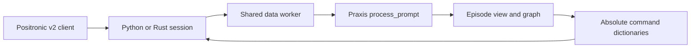

# Praxis Positronic observation handoff

The Python and Rust `/api/v1/session` frontends validate the session id and
forward the original binary request frame. The shared data worker decodes it
once. It sends the latest frame from each camera as `image_inputs`, and the
latest client-frame pose as `robot_state`. The Praxis model converts that pose
to its model frame before proprio and command composition. `pose_descriptor`,
`control_mode`, and `action_format="positronic"` travel with the model request.
The worker also passes prior camera and pose rows to `process_prompt` as
`executed_frame_inputs` and `executed_pose_inputs`.

## Executed frame window for warm calls

The session frontend keeps one scalar: the last reply's action row count. It
sends that as `executed_rows` on the next request, or zero for a first or
explicitly reset request. The data worker checks the camera stacks. If a
camera has too few prior rows, it sends `reset_episode` and
`executed_rows=0` to the conductor before admission, and gives the model empty
prior tensors. A first or explicitly reset call also gets empty prior tensors,
even if the client sent a frame stack. The startup capability gate remains
closed until the Praxis model and episode state can consume these tensors.

The pinned single-arm reference's `executed_clip(obs, need)` uses rows
`[-(need + 1):-1]` from both camera stacks. `pose8_history` selects the same
rows from the pose and grip stacks. The current row is `[-1]` and does not
belong to the executed window. The bimanual reference applies the same window
to all three views and both arm poses. If the necessary stack is missing or
short, the reference restarts context at depth zero. Missing pose history is
different: the reference keeps the camera clip and passes no pose history.

The worker passes exactly `executed_rows` prior camera rows, excluding the
current row, as uint8 `(T,3,H,W)` stacks. When matching pose and grip history
is present it passes a raw float32 `(T,8 or 16)` pose stack; otherwise that
tensor has zero rows while the camera window stays warm. The model uses
`EpisodeView` and `executed_rows` to select its append
span. On the first warm call, the cold seed already holds the first real row,
so the model appends the final 20 of the 21 prior rows. Later calls append the
final 24. The model must encode those real frames and retain clean state in
its declared episode resources. Reset discards that state before using the
request's current frame. No frontend cache or frame data in `step_metadata`
is needed.

The parser, data-worker and binary transport tests cover cold, subsequent,
short-stack reset and explicit reset requests. They do not establish warm
model output parity. That gate needs the episode-aware Praxis model and a CPU
reference test for executed-frame encoding before
`POSITRONIC_SESSION_READY` can be set.
