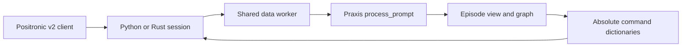

# Praxis Positronic observation handoff

The Python and Rust `/api/v1/session` frontends validate the session id and
forward the original binary request frame. The shared data worker decodes it
once. It sends the latest frame from each camera as `image_inputs`, and the
latest client-frame pose as `robot_state`. The Praxis model converts that pose
to its model frame before proprio and command composition. `pose_descriptor`,
`control_mode`, and `action_format="positronic"` travel with the model request.

## Executed frame window for warm calls

The current adapter is a cold input handoff. It deliberately selects the last
camera and pose row. It does not preserve an earlier stack row in episode
state, so it must not claim warm Praxis parity or declare the model ready for
Positronic sessions yet. The startup capability gate rejects that deployment.

The pinned single-arm reference's `executed_clip(obs, need)` uses rows
`[-(need + 1):-1]` from both camera stacks. `pose8_history` selects the same
rows from the pose and grip stacks. The current row is `[-1]` and does not
belong to the executed window. The bimanual reference applies the same window
to all three views and both arm poses. If the necessary stack is missing or
short, the reference restarts context at depth zero.

Warm serving needs the model to read that aligned executed window, encode the
real frames, and retain the resulting clean state through the E2/E3 episode
view. Reset must discard that state before using the request's current frame.
The window belongs to the model's declared episode resources. It must not
become a separate frontend cache or an unbounded `step_metadata` value.

The parser's current-frame and binary transport tests cover cold, subsequent,
and reset requests. They do not establish warm model output parity. That gate
needs an episode-aware Praxis model and a CPU reference test using executed
camera and pose stacks before `POSITRONIC_SESSION_READY` can be set.
