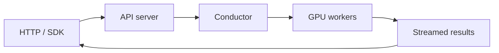

**M\*** ("M-star") serves models built from structurally distinct components:
vision encoders, transformer backbones, diffusion and flow heads, audio codecs,
action generators, and world-model predictors. Their execution paths change with
the input and the task.

The core abstraction is the **graph walk**. Each model declares its computation as
a dataflow graph of components, and each request is a walk over that graph. Logical
graph structure is independent of physical placement: the same model runs on one
GPU or across multiple GPUs by changing a YAML configuration.

One runtime serves unified multimodal models, omni models, speech language models,
vision-language-action policies, and world models through a **Python SDK**, an
**OpenAI-compatible API**, and a native streaming endpoint.

<CardGroup cols={2}>
  <Card title="Install M*" icon="download" href="/installation">
    Set up your environment and install the model dependencies.
  </Card>
  <Card title="Run your first request" icon="bolt" href="/quickstart">
    Start a server and generate text, images, or speech.
  </Card>
  <Card title="Explore the architecture" icon="diagram-project" href="/architecture">
    Follow a request through the API server, conductor, workers, and engine.
  </Card>
  <Card title="Guides and reference" icon="book-open" href="/reference">
    Find model support, serving configuration, client APIs, and contributor guides.
  </Card>
</CardGroup>

## From request to result

The conductor coordinates graph walks across workers. Each worker runs ready
components through an engine that handles batching, resource management, and
accelerator graph capture. Learn more in the [architecture guide](/architecture).
