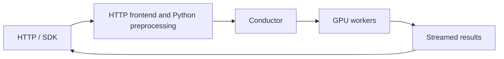

M* ("M-star") serves models that generate or process text, images, speech, video, and actions. Start with a supported model and deployment config, then send requests through the Python SDK, an OpenAI-compatible endpoint, or the native API. Available interfaces depend on the model and task.

<CardGroup cols={2}>
  <Card title="Run your first request" icon="bolt" href="/quickstart">
    Install M*, start BAGEL, and get a text response.
  </Card>
  <Card title="Choose a model" icon="list" href="/models">
    Find model dependencies, inputs, and deployment examples.
  </Card>
  <Card title="Configure a deployment" icon="server" href="/serving">
    Select GPU placement, transport, and a frontend.
  </Card>
  <Card title="Connect a client" icon="terminal" href="/clients">
    Choose the SDK, an OpenAI endpoint, or the native API for your task.
  </Card>
</CardGroup>

New environment? Start with [Installation](/installation). For monitoring, evaluation, and contributor documentation, see [Guides and reference](/reference).

## From request to result

A model declares a graph of components, such as an encoder, a transformer, or an audio decoder. Each request follows graph walks through those components. The deployment YAML assigns nodes to GPU ranks, so supported placement changes do not require rewriting the model.

The conductor coordinates graph walks; workers execute ready nodes and return results. Read [Architecture](/architecture) for the execution flow and resource ownership, or [Adding models](/adding_models) to implement a model.
